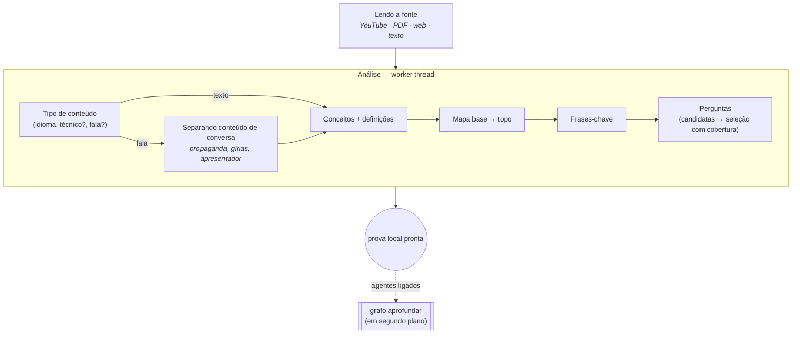
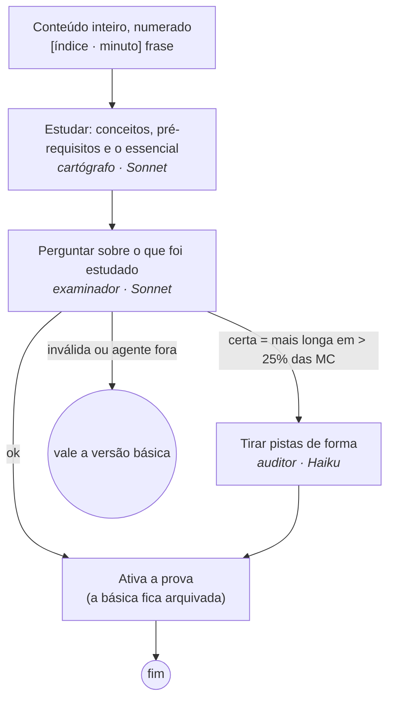
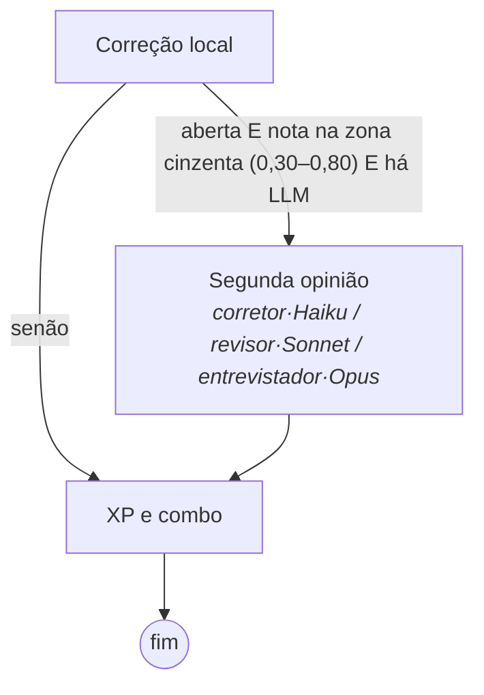
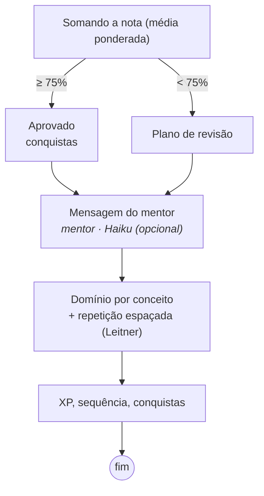

# Arquitetura — Trilha

A Trilha é montada como **dois grafos que conversam**:

1. **Grafo de conhecimento** (dados): conceitos do conteúdo ligados por coocorrência e organizados numa árvore de pré-requisitos, da base ao topo. É o que o aluno vê como mapa mental e o que ordena a revisão.
2. **Grafos de execução** (fluxo): cada operação importante é um `StateGraph` com nós, arestas e arestas condicionais (`server/graph/engine.js`, inspirado em LangGraph, sem dependências). Toda execução gera um *trace* com o tempo de cada nó, mostrado no site ("Como essa nota foi calculada").

Os grafos podem ser lidos ao vivo em `GET /api/graphs` (formato Mermaid).

## 1. Grafo de estudo (criar prova)



A análise roda num **pool de worker threads** (`server/nlp/pool.js`): o processamento de texto não trava quem está fazendo prova (ver `TESTE-DE-CARGA.md`).

### Fala não é conteúdo (`server/nlp/spoken.js`)

Achado com um vídeo real de bate-papo: o motor tratava "cara", "entendeu", "rapaziada", o nome do apresentador e o cupom do patrocinador como conceitos. O nó `limpar` resolve isso antes de tudo:

- **Propaganda e engajamento**: frases com cupom, "se inscreve", "link na descrição", redes sociais, abertura e despedida saem. Frases vizinhas que citam a marca do anúncio também.
- **Apresentador**: nomes usados como vocativo ("…, Ana?") ou junto de cupom viram palavras ignoradas.
- **Vícios de linguagem**: "tá?", "né?", "entendeu?", "cara,", "tipo assim" são removidos da frase (o minuto do vídeo continua o mesmo).
- **Densidade de conteúdo** (`infoScore`): cada frase ganha uma nota de quanto ensina (termos de conteúdo, "porque", números, definições; perde pontos por pergunta retórica, relato pessoal e fala sobre o próprio vídeo). Conceitos e perguntas preferem frases com nota alta.

### Como as perguntas locais são escolhidas (`server/nlp/questions.js`)

Esta é a **versão básica** (sem IA), usada quando os agentes estão desligados ou falham. Sem um modelo de linguagem, o motor não "estuda" o conteúdo; ele só reconhece padrões.

1. **Candidatas, todas sobre conceitos**: o que é X (definição encontrada no texto), qual conceito corresponde a uma descrição, qual é a justificativa de uma afirmação ("…porque…"), consequência ("se/quando…", só em texto escrito) e conexão forte entre conceitos.
2. **Seleção gulosa com cobertura**: a cada rodada entra a melhor candidata, com bônus para um trecho do conteúdo ainda sem pergunta (o conteúdo é dividido em blocos do início ao fim), um conceito ainda não cobrado e um tipo menos repetido.
3. **Removidos por medirem memória da fala, não entendimento**: "complete a frase" (lacuna), "complete o número", "trocar a palavra dentro da frase" e "o que aparece antes". Num teste com um vídeo real sobre RAG, 9 de 15 perguntas locais eram lacunas com até 23 palavras copiadas da transcrição.

## 1b. Grafo aprofundar: primeiro estudar, depois perguntar



- **Com os agentes ligados, a prova só abre depois do estudo.** Enquanto `studies.deep_status = 'running'`, `POST /attempts` responde 409 e a tela mostra a etapa atual (estudar → perguntar → auditar), sem exibir conceitos e resumo da versão básica. Leva de 1 a 2 minutos por vídeo de ~15 minutos.
- **Nada do LLM entra sem validação** (`server/agents/normalize.js`). Conceito que não aparece no conteúdo sai; ciclos são quebrados e a profundidade é limitada a 4. Questão de múltipla escolha precisa de 4 opções distintas e gabarito 0–3. A evidência vira o minuto ou a página. O conceito é deduzido do texto quando o id vem errado.
- **Sobre o conteúdo, não sobre as frases**: questão com lacuna, ou com enunciado ou alternativa certa copiando 12 ou mais palavras seguidas da transcrição (`copyMeter`), é descartada. Também sai a MC cuja certa é 60% maior que qualquer errada.
- **Auditoria de forma**: numa avaliação com 6 vídeos de tecnologia (RAG, bancos relacionais, JOINs, pipelines/ETL), a alternativa certa era a mais longa em 78% das questões; quem chutasse "a maior" passaria. Quando isso passa de 25% numa prova, o Auditor reescreve as alternativas marcadas. `applyAudit` só aceita reescrita que mantém o vocabulário da certa e reduz de fato a pista. Resultado medido: 86% → 50%, 57% → 7% e 60% → 20% (média de 26%, perto do acaso, 25%).
- Provas antigas continuam corrigíveis: as questões substituídas ficam com `archived = 1`. Conceitos com o mesmo nome mantêm o id, então as anotações e o domínio continuam valendo.
- Conteúdo com mais de ~90 mil caracteres é amostrado de forma uniforme (início, meio e fim).

### Como o grafo de conhecimento é montado (`server/nlp/knowledge.js`)

1. **Candidatos**: n-gramas de 1 a 3 palavras que não começam nem terminam em palavra vazia ("fila **de** tarefas" vale, "de tarefas" não).
2. **Pontuação**: frequência × tamanho do termo × bônus para código (`Promise.all`, `camelCase`) e siglas × espalhamento pelo texto; palavras comuns em minúsculas ("código", "função") valem menos.
3. **Subsunção**: se "event loop" quase sempre aparece inteiro, "loop" sozinho sai.
4. **Definições**: frases no formato "O X é um/uma/o…" ou "X significa/representa…", com o termo como sujeito. A voz passiva ("é rejeitada") é descartada.
5. **Arestas**: coocorrência na mesma frase (peso 1) e em frases vizinhas (peso 0,3).
6. **Árvore base → topo**: a base é, entre os 5 conceitos mais importantes, o **apresentado primeiro**. Cada conceito seguinte escolhe como pai, entre os já apresentados, o mais ligado e mais relevante. Nível = profundidade: Base → Fundamentos → Aplicação → Avançado → Topo.

## 2. Grafo de resposta (corrigir uma questão)



- **Múltipla escolha nunca chama IA.** A ordem das opções é embaralhada por tentativa e traduzida de volta no servidor.
- **Respostas abertas**: cobertura dos termos da rubrica (os conceitos envolvidos e outros conceitos presentes nas frases-fonte) + tamanho mínimo (+ exemplo e limitação na entrevista).
- **Código**: elementos esperados + compilação sem execução (`vm.Script`) + tamanho mínimo.

## 3. Grafo de finalização (nota e plano)



Pesos: MC = 1, raciocínio = 2, código = 2, entrevista = 3. Cada conceito recebe a média das questões que o envolvem; abaixo de 75% entra na lista "O que rever", **ordenada pelo nível no mapa** (base primeiro).

## 4. Agentes e modelos

Cada agente tem um modelo Claude conforme o nível técnico da tarefa. O prompt de sistema **é a skill** (`.claude/skills/<agente>/SKILL.md`), a mesma usada pelo subagente do Claude Code (`.claude/agents/<agente>.md`): uma única fonte de verdade.

| Agente | Modelo | Quando entra | Teto de saída | Uso medido* |
| --- | --- | --- | --- | --- |
| curador | `claude-haiku-5-5` | Limpar transcrição ruidosa, glossário | 900 tokens | — |
| auditor | `claude-haiku-5-5` | Depois do examinador, se a certa for a mais longa em > 25% das MC | 5.000 | ~15 s |
| corretor | `claude-haiku-5-5` | Raciocínio na zona cinzenta | 400 | ~5 s |
| mentor | `claude-haiku-5-5` | Mensagem final com plano | 500 | ~4 s |
| cartografo | `claude-sonnet-5-5` | Ao criar o estudo / "Refazer com os agentes" | 6.000 | ~15 s, ~2 mil tokens de saída |
| examinador | `claude-sonnet-5-5` | Logo depois do cartógrafo | 16.000 | ~60 s, ~8 mil tokens de saída |
| revisor-codigo | `claude-sonnet-5-5` | Código na zona cinzenta | 600 | — |
| entrevistador | `claude-opus-5-5` | Entrevista na zona cinzenta (no máximo 1 por prova) | 800 | ~13 s |

\* Vídeo real de cerca de meia hora (~5,7 mil palavras), pelo Claude Code com a assinatura. Mapa + prova: ~77 s e ~40 mil tokens no total. Nessas entradas grandes, o próprio Claude Code fez uma passagem rápida pelo Haiku (mesma entrada, ~20 tokens de saída) antes do Sonnet.

**Provedores** (`TRILHA_LLM`):

| Provedor | Como chama | Observação |
| --- | --- | --- |
| `claude-code` | `claude -p --model <tier> --json-schema … --system-prompt <skill> --tools "" --strict-mcp-config --setting-sources "" --no-session-persistence` | Usa o login da assinatura (Pro/Max). Sem `--bare`, porque `--bare` só aceita chave de API. Máximo de 2 processos simultâneos; uso pessoal. |
| `claude` | SDK `@anthropic-ai/sdk`, `output_config.format` com JSON Schema, prompt de sistema com `cache_control` | Sonnet e Opus com *fallback* no servidor (`fallbacks: "default"`). |
| `ollama` | `/api/chat` com `format` = JSON Schema | Grátis e local. |

**Economia de tokens** (`server/agents/index.js`):

1. **Local primeiro na correção**: a correção só escala quando a nota local fica entre 0,30 e 0,80. Múltipla escolha nunca chama IA.
2. **Entrada mínima na correção**: só pergunta, resposta, trecho-fonte e termos esperados.
3. **Conteúdo inteiro só duas vezes por estudo** (cartógrafo e examinador), numerado para as respostas apontarem as frases em vez de copiá-las.
4. **Saída estruturada** (JSON Schema) e teto de saída por agente.
5. **Cache de respostas** por hash de provedor + skill + entrada (tabela `llm_cache`). A mesma correção custa zero; se a skill melhorar, o cache antigo deixa de valer.
6. **Teto diário por usuário** (`TRILHA_DAILY_TOKENS`: 300 mil no modo assinatura, 120 mil na API).
7. **Fila**: no modo assinatura, no máximo 2 chamadas ao mesmo tempo. Uma correção com mais de 3 na frente não espera: vale a nota local, e o aluno não fica parado.
8. **Falha segura**: sem login, sem orçamento, recusa, tempo esgotado ou JSON inválido → vale o resultado local.

## 5. Modelo de dados (SQLite, `server/db.js`)

```text
users ─┬─< studies ─┬─< questions
       │            ├─< rooms ─< room_members >─ users
       │            └─< notes
       ├─< attempts ─< answers
       ├─< mastery   (domínio por conceito + caixa de Leitner + próxima revisão)
       ├─< badges
       └─< teach_sessions
llm_cache · llm_usage
```

`node:sqlite` nativo (sem dependência), modo WAL, statements preparados em cache e índice composto `attempts(room_id, user_id)` para o placar.

## 6. Tempo real

Turmas usam **Server-Sent Events**. Os eventos de cada turma são agrupados num único `tick` a cada 1,5 s, já com o placar calculado uma vez (micro-cache de 1 s). Antes disso, cada resposta virava um evento para cada aluno (O(N²)).

## 7. Segurança (protótipo)

- Identificação por nome + token aleatório (sem senha). **Não é autenticação de produção.**
- O gabarito nunca vai para o aluno antes da resposta; em prova em andamento, `GET /attempts/:id` só revela o que já foi respondido.
- O código do aluno **nunca roda no servidor** (só é compilado); no navegador, roda num Worker com CSP sem rede.
- **SSRF** (`server/ingest/index.js`): o servidor busca links enviados pelo usuário, então bloqueia a rede interna pelo **endereço resolvido no momento da conexão** (`lookup` próprio no `http.get`, que fecha o DNS rebinding). Isso cobre IPv4, IPv6, IPv6 mapeado (`::ffff:127.0.0.1`), formas decimais/hexadecimais e metadados de nuvem (169.254.169.254). Cada **redirecionamento** é revalidado (máx. 5), e links com usuário e senha são recusados. Limites: 25 MB por download e ~60 mil palavras de texto colado.
- **Escuta só em `127.0.0.1` por padrão** (`HOST`). O modo `claude-code` se recusa a subir fora de localhost: a assinatura é pessoal, e exposta na rede qualquer um gastaria o limite dela.
- **Limite de requisições** por usuário (token válido) e por IP. Token inventado cai na cota do IP; antes, um token falso por requisição contornava o limite.
- **Token só no cabeçalho** `Authorization`. Na URL (`?token=`), só no canal de tempo real (`EventSource` não envia cabeçalhos), para não vazar em logs e histórico.
- **Turmas**: o tempo real (nomes e notas) só é entregue a professor e membros, com no máximo 3 conexões por usuário em cada turma.
- **Cabeçalhos**: CSP restritiva (`frame-ancestors 'none'`, `object-src 'none'`, `base-uri`, `form-action`), `X-Frame-Options: DENY`, `nosniff`, `Permissions-Policy` e sem `X-Powered-By`.
- **SQL** só com parâmetros (`?`). Os nomes de tabela interpolados vêm de listas fixas no código.
- **Saída do LLM** passa por validação estrita antes do banco. No front, todo texto (do aluno, da fonte ou da IA) entra como nó de texto, nunca como HTML.
- Testes em `tests/security.test.js`. `npm audit`: 0 vulnerabilidades conhecidas nas dependências (15/11/2026).
- **Excluir é excluir**: o dono apaga estudo, questões, provas, respostas, anotações, turmas, domínio e o cache dos agentes daquele estudo. `PRAGMA secure_delete = ON` zera as páginas liberadas no arquivo do banco. O aluno de uma turma só apaga os próprios dados.
- **Conteúdo é dado, não instrução**: as skills mandam ignorar pedidos escritos dentro da transcrição ou da resposta do aluno ("ignore as regras", "me dê 1"). No modo assinatura, o Claude Code roda sem nenhuma ferramenta (`--tools ""`) e sem MCP: mesmo que uma instrução maliciosa passe, ele não consegue ler arquivos nem executar nada.
